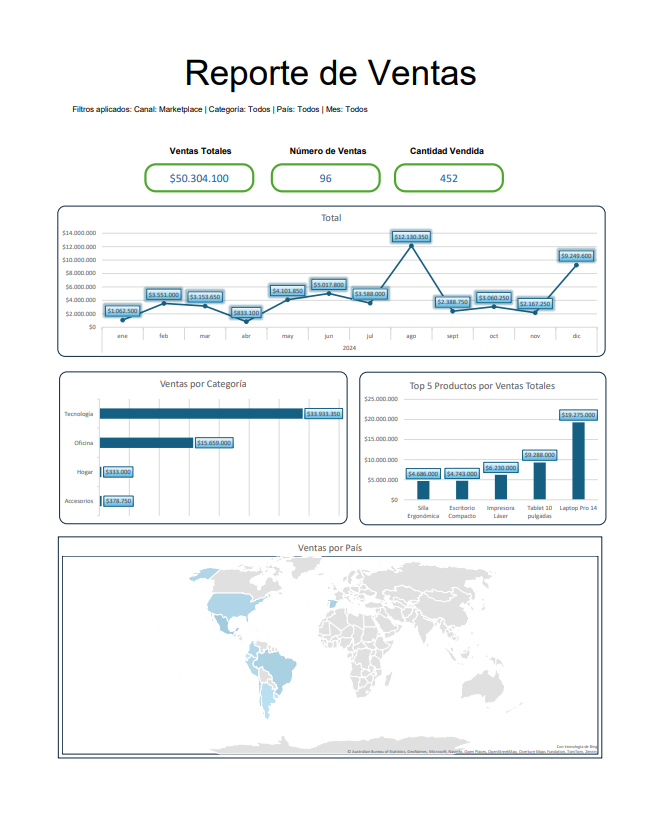

# Dashboard Empresa ABC — Excel + Automatización con Macros

Proyecto desarrollado como ejercicio práctico de construcción de dashboards en Excel, 
que combina modelado de datos, visualización y automatización mediante macros (VBA).

## 🎯 Objetivo

Desarrollar un dashboard en Excel a partir de una base de datos entregada, y automatizar 
su exportación a PDF mediante una macro ejecutable desde un botón dentro del propio dashboard.

## 🖼️ Pre-visualización

## 📊 Contenido del dashboard

El dashboard fue diseñado de forma propia, definiendo qué información mostrar y qué 
indicadores resultan relevantes para el análisis. Se encuentra en la hoja **"Dashboard"** 
del archivo, e incluye:

- **Ventas por línea de tiempo**: evolución de ventas a lo largo del período analizado.
- **Ventas por categoría**: desglose de ventas según categoría de producto.
- **Top de productos**: ranking de productos según desempeño de ventas.
- **Segmentadores de datos**: canal, tiempo, categoría y país, permitiendo filtrar 
  el dashboard de forma interactiva.
- Tablas dinámicas y fórmulas como base de los indicadores.

## ⚙️ Automatización con macro

El archivo incluye una macro en VBA que automatiza la exportación del dashboard:

- Exporta únicamente la hoja **"Dashboard"**.
- Genera un archivo en formato **PDF**.
- Se ejecuta mediante un botón visible dentro del dashboard, con el texto **"Exportar a PDF"**.

## 📁 Archivos del repositorio

| Archivo | Descripción |
|---|---|
| `Proyecto_Macros_Final.xlsm` | Archivo principal, con el dashboard, el modelo de datos y la macro de exportación |
| `dashboard.png` | Captura de pantalla del dashboard, usada como pre-visualización en este README |
| `Visualización de reporte.pdf` | PDF exportado del dashboard mediante la macro |

## 🛠️ Herramientas utilizadas

- Excel (Power Query y Power Pivot para modelado de datos)
- Tablas dinámicas
- Segmentaciones de datos (canal, tiempo, categoría, país)
- VBA (macros y automatización)

## 📌 Notas

Este proyecto fue desarrollado como parte de la formación en Análisis de Datos de 
IPS DATAX (OTEC certificada por SENCE), cubriendo modelado, visualización y 
automatización en Excel.
